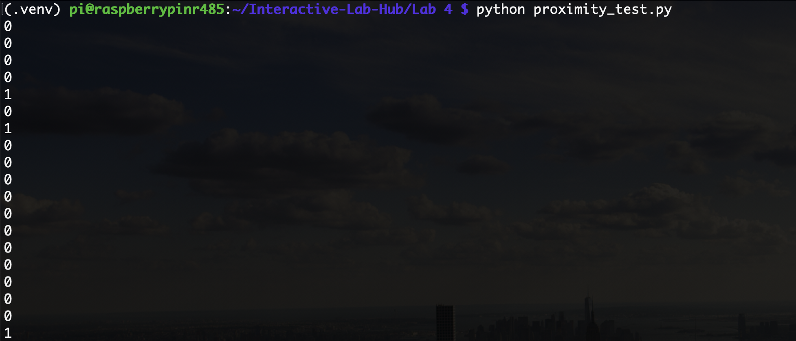
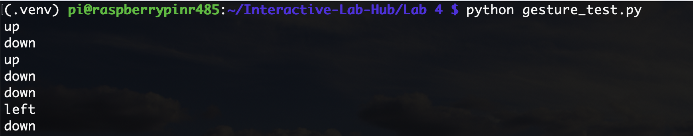
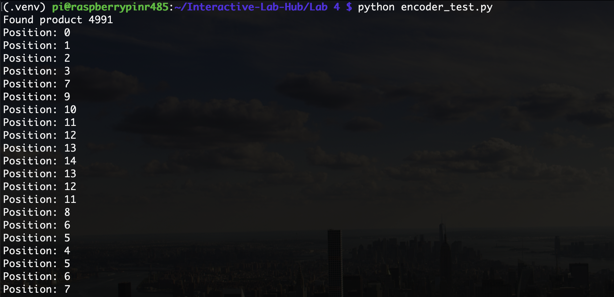
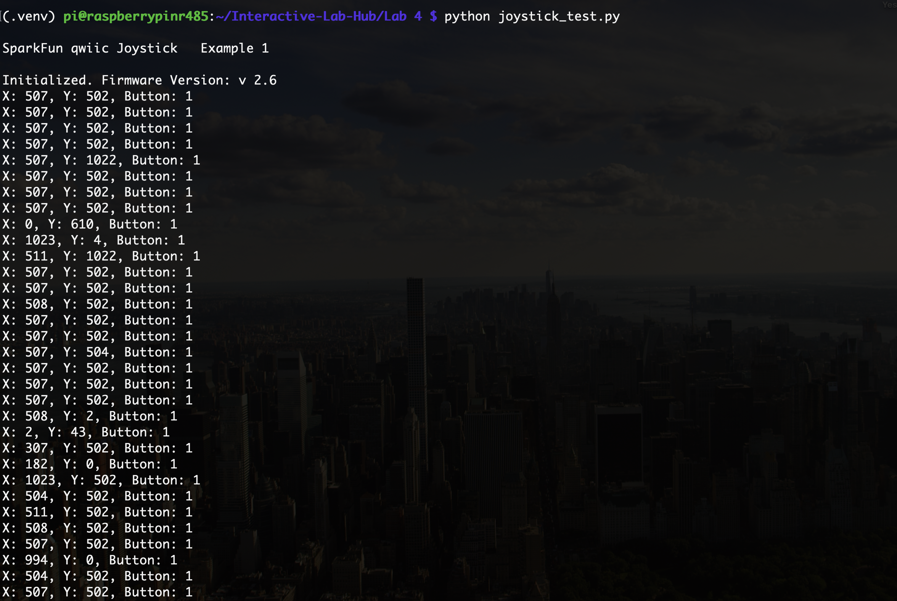
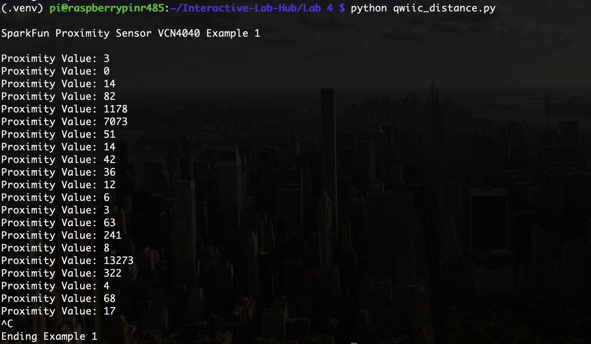
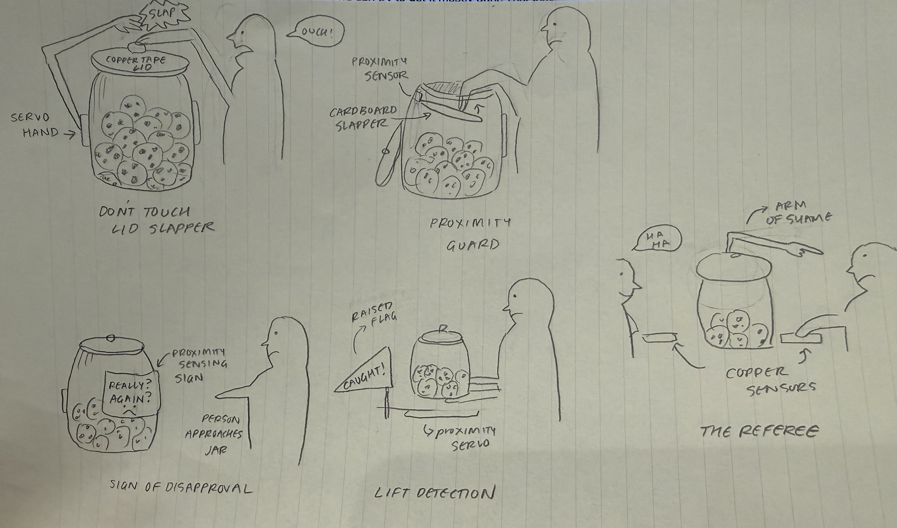
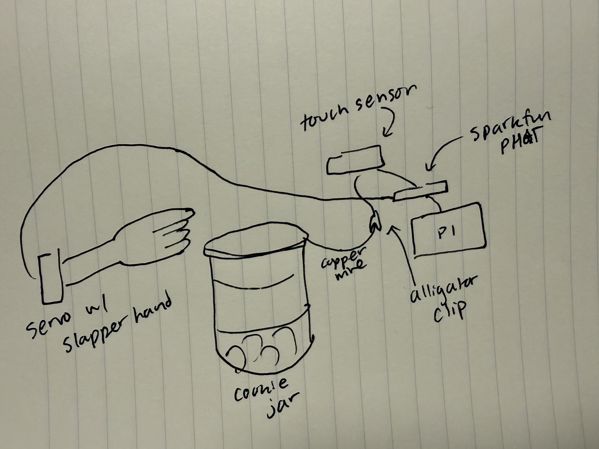
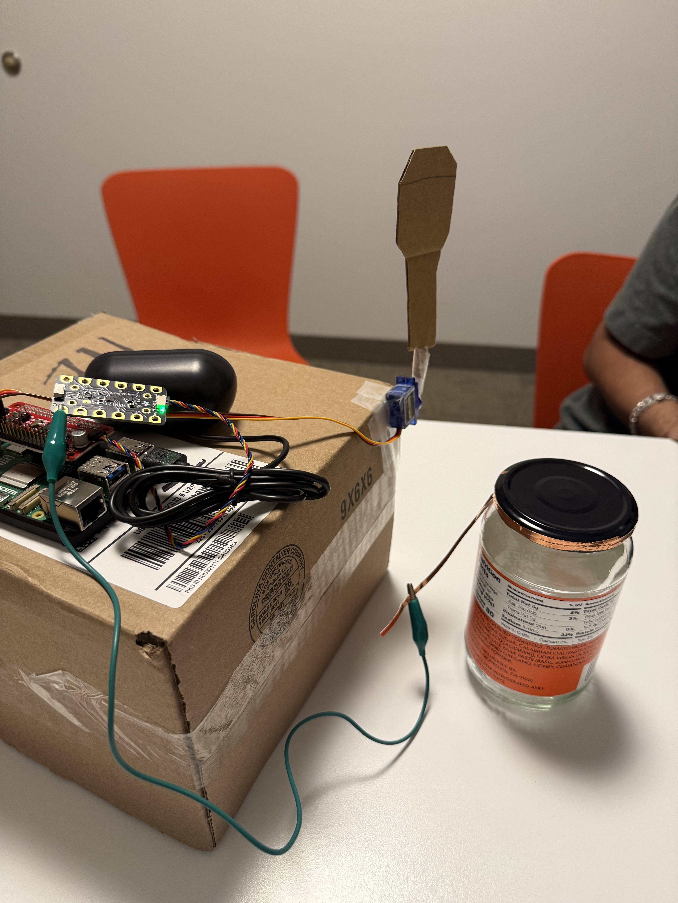

# Ph-UI!!!

## Lab Overview
Members: [Neeha Ravula](https://github.com/neeharavula/Interactive-Lab-Hub/tree/Fall2026) (nr485), [Gaurav Patel](https://github.com/Gtpatel02/Interactive-Lab-Hub) (gp438), [Nishant Ray](https://github.com/Nishant-Ray/Interactive-Lab-Hub) (nr487), [Ammar Syed](https://github.com/ammarsyed/Interactive-Lab-Hub) (as4422)  
Project name: No Cookies For You

---

## Lab Structure

A) [Capacitive Sensing](#part-a)

B) [More Sensors](#part-b)

C) [Servo Actuation](#part-c)

D) [Physical Interaction Design: Feast Automata](#part-d)

E) [Build & Integrate](#part-e)

F) [Final Documentation](#part-f)

---

### Part A
### Capacitive Sensing, a.k.a. Human-Twizzler Interaction

---

### Part B
### More sensors

#### Light/Proximity/Gesture sensor (APDS-9960)

Proximity Test:

Gesture Test:

Color Test:

#### Rotary Encoder 

Encoder Test:

#### Joystick 

Joystick Test:

#### Distance Sensor

Distance Test:

---

### Part C
### Servo Control with SparkFun Servo pHAT

Pi Servo Hat Test:

https://github.com/user-attachments/assets/c1050344-a5b8-4634-8886-e160c8ab1e0c

---

### Part D
### Physical Interaction Design: Feast Automata

#### Sketches

#### Questions:
1. Can the capacitive sensor detect a touch through copper tape on a lid that’s handled constantly, or will normal jar handling cause false triggers?
2. Does the proximity sensor inside the rim reliably detect a hand entering the jar, or do the cookies themselves set it off?
3. Does the device need a base to keep it stable when the servo moves?
4. Should the jar react differently the more cookies someone takes, for example by escalating from a raised eyebrow to a slap?
5. At what distance should the face start “judging”? If it’s too sensitive, it reacts to people walking past; if it’s not sensitive enough, it reacts after the cookie is already gone.

#### What we physically prototype:
- Copper tape on the jar lid with the cap sensor
- Proximity sensor at the jar rim
- Cardboard arms of different lengths on the servo
- A cardboard base or housing for the electronics
- Cardboard faces and signs
- Physically move the prototype ourselves

#### Chosen Design

We have decided to choose the first design, Don't Touch Lid Slapper.
We chose this because first off, the capacitive touch on the lid is the most direct trigger, since you have to touch the lid to open the jar. It is also pretty funny and it is very easy to see what it is trying to do, keep you healthier so you don't eat cookies. Also we can fit everything under the jar so it is easy to keep hidden and act like it's a normal jar even if it is not.

#### Rough Prototype

https://github.com/user-attachments/assets/0f6227e5-fb5c-4058-a73d-d29ca764ee2d

---

## Part 2

---

### Part E

#### Build & Integrate: Sensing + Actuation

**Questions to consider:**
- How does your chosen sensor or input shape the physical response?  
We used capacitive touch through copper tape on the lid, so the jar only reacts when someone actually touches the lid. That’s the moment they’re about to take a cookie. Because the trigger is so direct, the response can be direct too: the arm slaps the hand that touched the lid. A touch either happens or it doesn’t, so the jar can’t tell how close someone is. That’s why we made it react to how many times you try instead of how close you get. The 1st touch gets a warning wiggle and “I see you. Put it down.” The 2nd gets one slap. The 3rd and after get a double slap and “Cookie police!” The code only counts a new touch, not a hand resting on the lid, so holding the lid doesn’t set off a string of slaps. The only issue we did have is that when we moved the sensor/jar, there seemed to be a response that was given but besides that it would only work when we touched the jar.

- How does the physical arrangement of the sensor and actuator change the interaction? 
The copper tape is on the lid and the servo arm is mounted right next to it, so the slap lands where the hand is. That makes the cause and effect obvious, because you touch the lid and get slapped right there. We put the electronics on top of a box next to the jar. The USB speaker gives the jar a voice, so it feels like a character scolding you instead of a machine. It tells you that it is a normal cookie jar until you touch the lid and the moment you do it scolds you.

- What thresholds, timing, or movement patterns make the interaction feel clear or playful? 
1. Escalation: the jar gets angrier each time, so people understand they’re being warned and keep trying to see what happens next. That’s the playful part.
2. Slap motion: the arm swings out fast and pauses for 0.25 seconds so the hit lands, then comes back slowly. That makes it look like a deliberate slap, not a twitch.
3. Speaking while slapping: the jar talks at the same time the arm moves, so the line and the slap feel like one reaction.
4. Cooldown: a 1-second pause after each reaction keeps one long grab from counting as several touches.
5. Calm-down: after 10 seconds with no touches, the jar resets and says “Just a normal cookie jar.” That makes it feel like it’s pretending to be innocent again.

- What changes when you adjust the sensor placement or servo motion? 
What changes is that the smaller the hand the easier it stays upright rather than being floppy. Also the speed is fast but not fast enough to hurt. It's fast enough to react and immediately hit someone if they touch the jar but not fast enough to hurt them.

https://github.com/user-attachments/assets/f7cb4be7-61a9-4b04-9601-84aacb88ac08

#### Reflection

The code was fairly easy and reading a touch/moving a servo was simple. The challenging part was connecting the wires and sensors to the actual hardware. A challenging thing was that I kind of broke the Mini PiTFT cable hole, but it's not a big deal because I was able to use the pHAT instead. Regardless, it was really cool to see how physical stuff can change/be affected and how it makes the situation feel. It was pretty fun to see the escalation of how mad the thing got when people tried again. Overall, connecting sensing, movement, and physical form itself isn't too hard but thinking about how to connect them together and use them creatively to achieve a purpose or feeling to others is the hard part and thinking about the inputs and outputs of the system was a bit challenging but fun.

---

### Part F
Looks Like:

The Lid Slapper is meant to look like an ordinary cookie jar sitting on a counter. The servo, the Pi and the wiring are behind it in a cardboard base that is next to the jar, so nothing gives away that it’s watching you. The copper tape on the lid is decorated as part of the lid. The cardboard slap arm sits next to the jar on the cardboard box that is hiding all the stuff at rest, so it doesn’t stand out until it swings. The USB speaker is hidden inside the base with all the wiring, so the voice seems to come from the jar itself.

Works Like:

- Sensing: copper tape on the lid is wired to the MPR121 capacitive touch sensor, which detects the moment a hand touches the lid.
- Actuation: a micro servo on the Servo pHAT swings a cardboard arm to slap the hand away.
- Voice: the jar speaks through a USB speaker using the Piper voice from Lab 3.
- Escalation:
	- 1st touch: wiggles and says “I see you. Put it down.”
	- 2nd touch: slaps and says “I said no! Slap!”
	- 3rd touch and after: double slaps and says “Cookie police! Slap slap!”
- Reset: after 10 seconds with no touches, it calms down and says “Just a normal cookie jar.”
- Code: lid_slapper.py

Acts like:

Someone walks up to what looks like a normal cookie jar and reaches for the lid. As soon as they touch it, the jar warns them. Most people laugh and try again, and the second try earns a slap. Anyone who keeps going gets the double slap and “Cookie police!” If they give up and walk away, the jar goes quiet and pretends to be innocent until the next person comes along.

### Final Documentation

Prototype 1:

https://github.com/user-attachments/assets/aa66ecaa-af2f-425f-a0b5-2ca3e5dfdfb7

Prototype 2:

https://github.com/user-attachments/assets/b9fd525d-09a9-478c-9d07-0bf1d5ee08cd

Prototype 3:

https://github.com/user-attachments/assets/aba7e2db-6f55-4aeb-b81a-49c7455efde2

---
