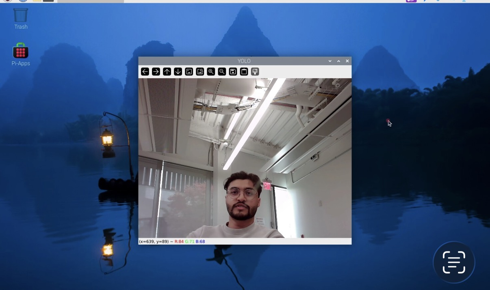
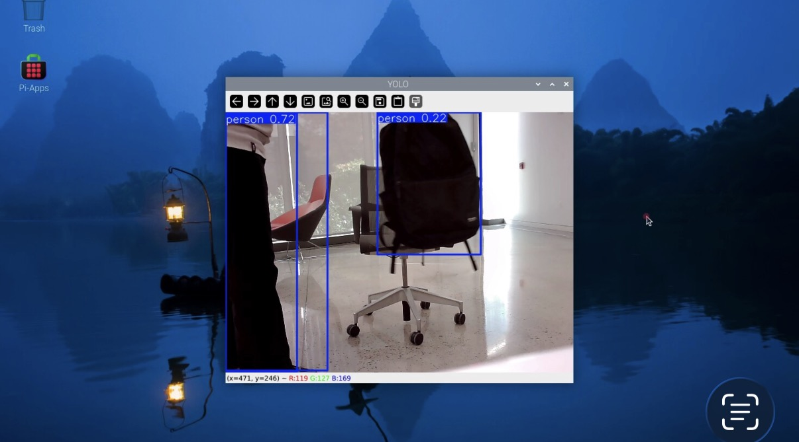
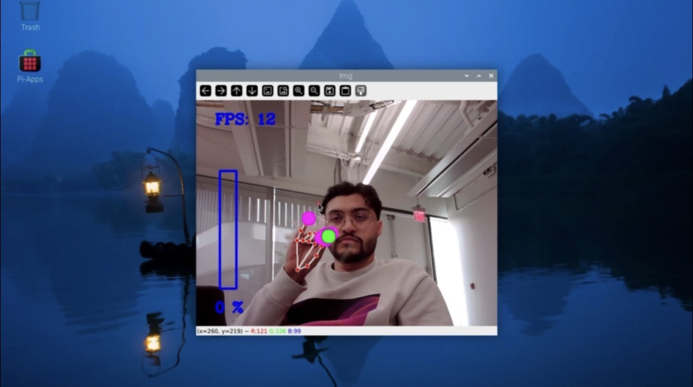
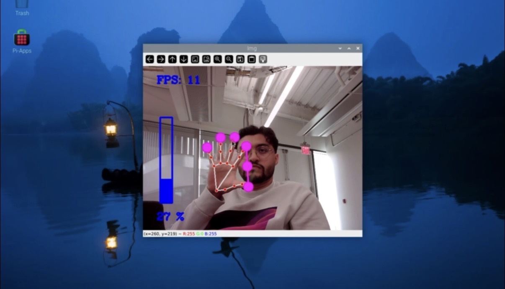
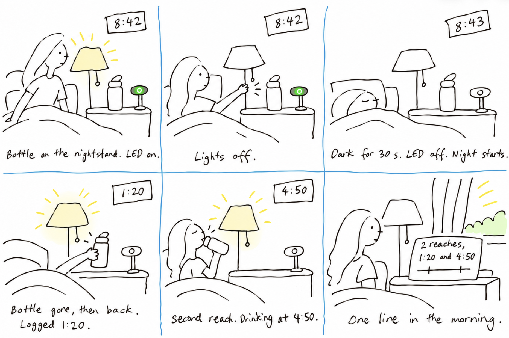

# Observant Systems: Overnight Sensation

**Team:**

**Members:** Full Name (netid, github-handle), ...

**Project name:**

<details>
	<summary><strong>Instructions for Students (Click to Expand)</strong></summary>
  
	**Submission Cleanup Reminder:**
	- This README.md contains extra instructional text for guidance.
	- Before submitting, remove all instructional text and example prompts from this file.
	- You may delete these sections or use the toggle/hide feature in VS Code to collapse them for a cleaner look.
	- Your final submission should be neat, focused on your own work, and easy to read for grading.
  
	This helps ensure your README.md is clear, professional, and uniquely yours!
</details>


For lab this week, we focus on creating interactive systems that can detect and respond to events or stimuli in the environment of the Pi, like the Boat Detector we mentioned in lecture. 
Your **observant device** could, for example, count items, find objects, recognize an event or continuously monitor a room.

This lab will help you think through the design of observant systems, particularly corner cases that the algorithms need to be aware of.

**New this year: the AI runs on the Pi.** Your Pi 5 can run an object detector ([YOLO](https://docs.ultralytics.com/)) and a small language model ([Qwen](https://ollama.com/library/qwen3.5) through [Ollama](https://ollama.com)) completely offline. In Part 1 you get both running and connect them: YOLO *sees*, Qwen *reasons* about what was seen. These models are slow, but they have all night. In Part 2 you use them to design a **night-time interaction**: what you tell the device before bed, what it does while you sleep, and what it shows you when you wake up.

**Please indicate anyone that helped with this Lab here.**
Be generous in acknowledging their contributions! And also recognizing any other influences (e.g. from YouTube, Github, Twitter) that informed your design. 

## Overview

**Part 1: the tools**

A) [Set up your Pi for on-device AI](#part-a)

B) [See: recognize people in real time with YOLO](#part-b)

C) [See more: hands and pose with MediaPipe](#part-c)

D) [Reason: run Qwen on the Pi with Ollama](#part-d)

E) [Connect: from YOLO readings to Qwen reasoning](#part-e)

**Part 2: Overnight Sensation**

F) [Read Part 2 and storyboard your night-time interaction](#part-f)

G) [Design the interaction before bed](#part-g)

H) [Incorporate the observant system during sleep](#part-h)

I) [Design the interaction when awake](#part-i)

The tools from earlier versions of this lab (MobileNet, Teachable Machine, Moondream, audio analysis, classic OpenCV) live in the [legacy folder](legacy/README.md). They are optional, but any of them can be the sensor in your Part 2 system.


## Prep for Part 1

Please check the instructions in [prep.md](prep.md) and complete them before lab. The installs in Part A take a while, so prep.md also tells you how to get a head start.

## The Report

This readme.md page in your own repository should be edited to include the work you have done. You can delete everything but the headers and the sections between the \*\*\***stars**\*\*\*. Write the answers to the questions under the starred sentences. Include any material that explains what you did in this lab hub folder, and link it in the readme.

---

# Part 1

## Part A. 
### Set up your Pi for on-device AI

Create a virtual environment and install the requirements. They include `ultralytics` (YOLO), which pulls in torch, so this takes a while:

```
pi@raspberrypi:~$ cd Interactive-Lab-Hub/Lab\ 5
pi@raspberrypi:~/Interactive-Lab-Hub/Lab 5 $ python3 -m venv .venv
pi@raspberrypi:~/Interactive-Lab-Hub/Lab 5 $ source .venv/bin/activate
(.venv) pi@raspberrypi:~/Interactive-Lab-Hub/Lab 5 $ pip install -r requirements.txt
```

As in Lab 3, [`uv`](https://docs.astral.sh/uv/) is a much faster drop-in for `pip`: `pip install uv && uv pip install -r requirements.txt`.

### YOLO: download the nano model and export it for the Pi

We use the nano model of [YOLO26](https://docs.ultralytics.com/models/yolo26/), exported once to NCNN, the format that runs fastest on the Pi. This downloads the weights:

```
(.venv) pi@raspberrypi:~/Interactive-Lab-Hub/Lab 5 $ python -c "from ultralytics import YOLO; YOLO('yolo26n.pt').export(format='ncnn')"
(.venv) pi@raspberrypi:~/Interactive-Lab-Hub/Lab 5 $ yolo export model=yolo26n.pt format=ncnn
```
If every ultralytics message is followed by a `--- Logging error ---` traceback ending in `UnicodeEncodeError: 'latin-1' codec can't encode character`, fix your shell's locale once::

```
echo 'export LANG=C.UTF-8' >> ~/.bashrc
echo 'export LC_ALL=C.UTF-8' >> ~/.bashrc
echo 'export PYTHONIOENCODING=utf-8' >> ~/.bashrc
source ~/.bashrc
```

The second command converts the .pt model to a .ncnn model.

Test it on an image from the internet. `project="$PWD"` keeps the output in `predict` in the current lab folder; without it, ultralytics writes to a `runs/` folder at the top of your git repo, where you will not think to look.

```
(.venv) pi@raspberrypi:~/Interactive-Lab-Hub/Lab 5 $ yolo predict model=yolo26n_ncnn_model source=https://ultralytics.com/images/bus.jpg project="$PWD"
```

The result is in `predict/bus.jpg`: boxes around the people and the bus.

Now a photo of your own. Plug in the webcam and take one with `snap.py` (`--delay 3` gives you three seconds to get into the frame), or choose any picture you downloaded from the internet and put under this folder. Put your selected picture after the `source=` Then run the same command on it:

```
(.venv) pi@raspberrypi:~/Interactive-Lab-Hub/Lab 5 $ python snap.py --delay 3
(.venv) pi@raspberrypi:~/Interactive-Lab-Hub/Lab 5 $ yolo predict model=yolo26n_ncnn_model source=snap.jpg project=runs
```

Every run gets its own numbered folder, so this one is in `runs/predict2/snap.jpg`; the command prints where it saved. Keep `snap.jpg`, you will show it to Qwen in Part D.

### Ollama: install it and pull Qwen

[Ollama](https://ollama.com) runs language models locally. Nothing leaves the Pi: no API key, no internet after the download.

```
pi@raspberrypi:~ $ curl -fsSL https://ollama.com/install.sh | sh
pi@raspberrypi:~ $ ollama pull qwen3.5:0.8b
pi@raspberrypi:~ $ ollama pull qwen3:0.6b
pi@raspberrypi:~ $ ollama list
```

| model | download | what it does |
|---|---|---|
| `qwen3.5:0.8b` | ~1.3 GB | text **and images**; the one we use in this lab |
| `qwen3:0.6b` | ~0.5 GB | text only, smaller and faster (~16 tokens/s on a Pi 5) |

\*\*\***Include a screenshot of `ollama list` showing your models.**\*\*\*


## Part B. 
### See: recognize people in real time with YOLO

YOLO is an *object detector*: it finds every person, cup, cat and so on (the 80 [COCO](https://cocodataset.org/) classes), draws a box around each, and gives a confidence. For an observant system that is exactly what you want: *how many*, *where*, *how sure*.

Connect your webcam, connect to your Pi through **VNC** (the script opens a window), and run the person detector. Read `yolo_person.py` first; the loop at the bottom is the whole idea.

```
(.venv) pi@raspberrypi:~/Interactive-Lab-Hub/Lab 5 $ python yolo_person.py
```

While it runs, walk in and out of the frame, sit down, turn your back, hold up a photo of a person on your phone. Watch the confidence number on the box change with each.

Then press q to quit and run it again with a flag. Each one changes a single thing:

```
(.venv) pi@raspberrypi:~/Interactive-Lab-Hub/Lab 5 $ python yolo_person.py --conf 0.2     # lower the bar: see what the model is unsure about
(.venv) pi@raspberrypi:~/Interactive-Lab-Hub/Lab 5 $ python yolo_person.py --conf 0.7     # raise the bar: see what you lose
(.venv) pi@raspberrypi:~/Interactive-Lab-Hub/Lab 5 $ python yolo_person.py --all          # all 80 classes, not only people: what else is on your desk, and what does it get wrong?
(.venv) pi@raspberrypi:~/Interactive-Lab-Hub/Lab 5 $ python yolo_person.py --headless     # no window, only the printed readings: how it runs over ssh, and at night
```

\*\*\***Include a short video or screenshots of your experiments with the person detection. Write down three situations where it did not see you, or saw a person who was not there, and what you think the cause was.**\*\*\*

**Video:** [Person detection over VNC, `yolo_person.py`](images/yolo-person-demo.mov) (person at 0.91 confidence)

**Bus test from Part A:**


**Where it didn't work:**

1. **Missed a person who was right there.** Centered, well lit, looking at the camera, and no box at all. The frame cuts off at the chest, so the model only has a head and shoulders to work with, and the bright window behind flattens the contrast. With the bar raised to `--conf 0.7` that was enough to drop below it. A detector trained on whole people is unsure about half of one.

   

2. **Saw a person who wasn't there.** With the bar lowered to `--conf 0.2`, a backpack on an office chair got a person box at 0.22. A dark, rounded shape at seated-torso height on a chair is what a person from behind looks like to the model. The 0.72 box on the left is a real person, cut off at the edge of the frame, which is the same partial-body problem as above but on the other side of the threshold.

   

3. *(third situation)*

The two failures pull in opposite directions. Raising the threshold loses real people at the edge of the frame or in bad light; lowering it invents people out of furniture. For an overnight system that means the threshold is a design choice about which mistake is cheaper, not a number to tune once.


## Part C. 
### See more: hands and pose with MediaPipe

YOLO tells you that a person is there. Google's [MediaPipe](https://mediapipe.dev/) tells you what their hands and body are doing: face, hand and body pose detection, fast on the Pi.


The demo plays a looping audio file, so make the helper script executable first:

```
(.venv) pi@raspberrypi:~/Interactive-Lab-Hub/Lab 5 $ chmod +x loop_audio.sh
```

Connect your webcam, connect to your Pi through **VNC**, and run the hand pose script:
(***it will not work if you use ssh from your laptop***)

```
(.venv) pi@raspberrypi:~/Interactive-Lab-Hub/Lab 5 $ python hand_pose.py
```

Try the two main features of this script: 1) pinching for percentage control (the thumb-to-index distance sets the volume), and 2) "[Quiet Coyote](https://www.youtube.com/watch?v=qsKlNVpY7zg)" for instant percentage setting (the gesture mutes it). Notice how this example uses hardcoded positions and relates those positions with a desired set of events, in `hand_pose.py`: a hand is 21 landmark coordinates, and an *event* is a rule you write over them. That is the same job as `interpret()` in Part E.

Consider how you might use this position based approach to create an interaction, and write how you might use it on either face, hand or body pose tracking.

\*\*\***Include a screenshot or short video of the hand pose demo, and write how you might use face, hand or body pose tracking in your observant system.**\*\*\*

**Video:** [Hand pose demo over VNC, `hand_pose.py`](images/hand-pose-demo.mov)

| pinch: thumb to index closed, volume 0 % | open hand, volume 27 % |
|---|---|
|  |  |

Both features worked at 11 to 12 frames per second over VNC. The pinch sets the volume from the thumb-to-index distance, so the bar follows the hand continuously; the open hand reads as a Quiet Coyote and drops it to zero. A hand is 21 landmarks and the "event" is a rule over two of them, which is the same shape as the interpreter in Part E: pixels in, a word out.

**How pose tracking could fit the water device.** Three places, in order of how much I'd trust them:

1. *The reach itself.* YOLO watches the bottle; MediaPipe could watch the hand. A hand entering the nightstand region and closing is a reach even if the bottle never leaves the frame, which catches the sip-without-lifting case the bottle-only version misses. In the dark this fails the same way YOLO does, so it's a second reading, not a replacement.
2. *A silent hand-off.* A pinch held toward the camera for two seconds could mean "night starts now," for anyone who doesn't turn the light off at bedtime. It keeps the no-words rule. The risk is a pinch that wasn't meant, so it would need the LED to confirm by going out.
3. *Posture, not identity.* Body pose could tell sitting up from lying down, which would let the morning line say "you sat up at 3:15" alongside the reaches. Face tracking is the one to avoid: the device doesn't need to know whose face it is, only that a hand went to the bottle, and the write-up should be able to say it never looked at a face.


## Part D. 
### Reason: run Qwen on the Pi with Ollama

Talk to the model in the terminal first. Qwen3 models "think" before they answer, which is slow on a Pi, so turn it off. Then ask about something you can check:

```
pi@raspberrypi:~ $ ollama run qwen3.5:0.8b
>>> /set nothink
>>> Tell me a bit about the history of Roosevelt Island. Three sentences.
>>> /bye
```

Roosevelt Island is a good first question because you know the ground truth: it was Blackwell's Island, then Welfare Island, got its current name in 1973, and Cornell Tech opened on it in 2017. Count how many of the model's facts are true.

From Python, qwen requests can be triggered by the `ask_qwen.py` script. It turns thinking off, tells the model to answer in at most three sentences, and cuts it off after 120 tokens (`--max-tokens` changes that), because a small model left alone writes an essay. Read the script, then run:

```
(.venv) pi@raspberrypi:~/Interactive-Lab-Hub/Lab 5 $ python ask_qwen.py "Tell me a bit about the history of Roosevelt Island."
(.venv) pi@raspberrypi:~/Interactive-Lab-Hub/Lab 5 $ python ask_qwen.py --model qwen3:0.6b "Tell me a bit about the history of Roosevelt Island."
(.venv) pi@raspberrypi:~/Interactive-Lab-Hub/Lab 5 $ python ask_qwen.py --image snap.jpg "What is in this photo?"
```

Things in the [Ollama API](https://github.com/ollama/ollama/blob/main/docs/api.md) worth knowing:

* `think: false` skips the reasoning trace. Always, on a Pi. `ask_qwen.py` sends it on every request; `--think` turns the trace back on for one question, so you can see what you are skipping and how long it takes.
* `format` makes the model answer as JSON with the fields you name (`--json`). Handy when a display or a servo has to read the answer.
* `images` sends a photo along with the prompt (`--image snap.jpg`, the photo from Part A). `qwen3.5:0.8b` can look at pictures.

A 0.8B model is slow and sometimes wrong. It will invent events that are not in the data and agree with a wrong premise. Give it the data, keep its job narrow, and decide what the device does when the model is unsure.

\*\*\***Ask Qwen three questions to answer. Paste the questions, the answers and how long each took. Try one of them with `qwen3:0.6b` and compare.**\*\*\*

<details>
  Q&A here
</details>


## Part E. 
### Connect: from YOLO readings to Qwen reasoning

An observant system is a pipeline: a **detector** turns pixels into boxes, an **interpreter** turns boxes into readings in words ("one person, left, close"), the readings pile up in a **log**, and a **reasoner** answers a question about the log. The language model never sees pixels, only the words you chose in the interpreter. That makes the interpreter the most important design decision in the system.

`yolo_to_qwen.py` is the pipeline in one file, one function per stage. Read it before you run it:

* `interpret(r)` is the interpreter. It takes one YOLO result and returns one reading. A person is *left*, *center* or *right* by which third of the frame the middle of their box is in, and *close* if the box is taller than 60% of the frame, *far* otherwise. The reading is a string like `1 person(s) at center/close`, or `nobody`. Fifteen lines, and they decide everything the model can know.
* `watch(seconds)` is the detector and the log. Twice a second it reads a frame, runs YOLO on it and calls `interpret()`. A time-stamped reading goes into the log **only when it differs from the previous one**, so a minute of sitting still is one line, not 120.
* `ask(log, question)` is the reasoner. It pastes the log and your question into one prompt, tells Qwen to answer in at most three sentences using only what is in the log, and sends it to Ollama with thinking off.

Run it through VNC and a window opens with YOLO's boxes, the current reading and the seconds left. Press q to stop watching early. Over plain ssh add `--headless` and you get the same thing minus the window.

```
(.venv) pi@raspberrypi:~/Interactive-Lab-Hub/Lab 5 $ python yolo_to_qwen.py
```

It watches for a minute, saves the log to `watch_log.txt` and asks Qwen the default question. The terminal looks something like this:

```
14:02:11 nobody
14:02:19 1 person(s) at right/far
14:02:24 1 person(s) at center/close
14:02:51 nobody

4 lines saved to watch_log.txt
asking Qwen...

Qwen (18.4 s):
One person came in from the right, moved close to the camera, and left after about half a minute. ...
```

---

# Lab 5 Part 2: Overnight Sensation

For Part 2, you will use the observant system from Part 1 to design a night-time interaction. On-device AI is slow, so let it work while you sleep. The person meets the device twice: **before bed**, when they hand the night over, and **when awake**, when the device gives something back. In between, the pipeline from Part E runs on its own.

Two flavors, pick one or mix them:

* **Sense all night.** The Pi watches, listens or measures from bedtime until morning and keeps a log.
* **Process all night.** You already have the data (a day of phone photos, a long recording) and the Pi needs hours to get through it.

Two house rules. Sample rather than stream: one look every 5 to 30 seconds is plenty, and it keeps the Pi cool. And keep everything on the Pi: tell the people you live with, point the camera at things rather than at beds, and delete the snapshots after the demo.

## Part F. 
### Read Part 2 and storyboard your night-time interaction

Storyboard a night-time interaction built on your observant system, in three panels:

1. **Before bed.** How does the person hand the night over, and how does the device acknowledge it?
2. **While asleep.** What does the device watch or work through?
3. **When awake.** What is the one thing the person learns, and in what medium?

Stuck? A kitchen that tells you who raided the fridge. A desk that reports whether you actually went to bed. A window that names the quietest hour. A plant that describes its night. Find something better.

Use storyboards and/or [Verplank diagrams](https://ccrma.stanford.edu/courses/250a-fall-2004/IDSketchbok.pdf).

\*\*\***Insert ideas, sketches, Verplank diagrams and storyboards for your night-time interaction here.**\*\*\*

### Part F: Water by the bed

**The idea.** A camera on the nightstand watches the water bottle. Overnight it logs whether the bottle is there and when it gets picked up. In the morning the device says how many times you reached for water and when. It measures something a sleep tracker can't, it never has to look at a face, and when nothing happened it says so.

**Storyboard, three panels:**



1. **Before bed.** The bottle goes on the nightstand, in front of the camera. The person turns off the light. That's the hand-off: no words, no button. Half a minute of dark and the device's green LED goes out, which is its acknowledgement.
2. **While asleep.** Every five seconds YOLO looks for a bottle or cup. If the box jumps, or disappears and comes back, that's a reach. Each one is logged with the time. If it's too dark to see, the device logs "dark" rather than guessing.
3. **When awake.** The screen shows one line: "You reached for the water twice, at 1:20 and 4:50," with a bar across the night and a tick for each reach. Or, on a quiet night: "The bottle never moved." Optionally the Lab 3 voice reads it out.

**Verplank, in short.** *Idea:* count how often the bottle is reached for overnight. *Metaphor:* a tally mark each time the bottle moves. *Model:* the person is told the device counts reaches, not sips. *Display:* a bar for the night, ticks for reaches, grey where it couldn't see. *Error:* a reach the camera missed in the dark is reported as "couldn't see," not as "didn't happen." *Scenario:* bottle down, light off, sleep, read one line in the morning. *Task:* nothing during the night; there is no input between lights-off and morning.

**Bellotti's five questions:**

- *Address.* How does the device know I'm talking to it? It doesn't need to. The only input is the light going off, which you'd do anyway. Nothing else it sees is treated as a command.
- *Attention.* How do I know it's listening? The green LED is on until the room has been dark for 30 s, then goes off. Off rather than on, so it adds no light to a dark bedroom.
- *Action.* How does it know what I want? The question is fixed: how often did you reach for water. There's no menu, so there's nothing to get wrong at midnight.
- *Alignment.* How do I know what it did? The morning line includes the times, so you can check them against your own memory, and it says how long it couldn't see.
- *Accident.* How do I undo a mistake? There's nothing to undo overnight. If the camera called a reach that wasn't one, the snapshot it saved shows what it saw, and the morning line can be ignored. The cost of an error is one wrong sentence.

**Where it will break, from Part B.** Darkness is the main one. A bottle in a dark room is a bottle the model can't see, so the device has to tell "gone" from "dark" apart, which it does from the frame's brightness. A reach in full dark won't be seen unless the lamp comes on. The other is a second bottle-shaped thing on the nightstand, a phone stood up or a lamp base, getting the box instead. The nightstand should hold the bottle and not much else.


## Prep for Part 2

1. Look at and give feedback on the Part F storyboards.
   **Put the feedback for your ideas here.**
2. [Update your Lab Hub](prep.md#get-the-latest-content) to get the latest content for Part 2.
3. Decide where the device will spend the night and who else lives there. Get their OK before the first run.
4. Revise your storyboard with the feedback and with what you learned in Part E about where the pipeline breaks.

\*\*\***Post your revised storyboard here.**\*\*\*

*(revised storyboard after class feedback)*


## Part G. 
### Design the interaction before

The hand-off: the person tells the device what to watch tonight, and the device acknowledges it. Keep it to a thirty-second ritual. A button or a touch (Lab 4), a spoken sentence (Lab 3), a wave or a Quiet Coyote at the camera (Part C). The acknowledgement can be a line on the display, a tone, or an LED that dims rather than lights up. At its simplest, the hand-off just sets the question that the morning will answer.

\*\*\***Describe the interaction before.**\*\*\*

### Part G: before bed

Put the bottle on the nightstand and turn off the light. That's it.

The device has been running since the evening with its green LED on, meaning "waiting for the night." When the frame's average brightness stays below a threshold for thirty seconds, it writes `night_start` to the log and turns the LED off. From that moment the morning report counts. The acknowledgement is a light going out rather than coming on, because a bedroom at bedtime doesn't want a new light in it.

There is no spoken line and no button on purpose. The earlier draft had the person say "goodnight" to the device; that was dropped because it adds a step to a ritual that already exists. The light switch is the ritual.

Threshold and timing are flags on `water_night.py` (`--dark`, `--night-after`), set once by reading the brightness in the actual room with the lamp on and off.


## Part H. 
### Incorporate the observant system

The Part E pipeline becomes the night shift. `overnight.py` runs your `interpret()` from `yolo_to_qwen.py` every few seconds, people only unless you pass `--all`, and writes the readings to `night_log.jsonl`; the reasoning waits for the morning. Start it inside `tmux` so it keeps running after you close your laptop, and stop it with Ctrl-C in the morning:

```
(.venv) pi@raspberrypi:~/Interactive-Lab-Hub/Lab 5 $ tmux new -s night
(.venv) pi@raspberrypi:~/Interactive-Lab-Hub/Lab 5 $ python overnight.py
```

Fake a night first: run it for thirty seconds while you walk around, stop it, and run `morning.py` from Part I. When that looks right, run a real night. If your storyboard needs a sensor rather than the camera, swap in the Lab 4 example code and log its reading the same way.

\*\*\***Screenshots or videos of the running system.**\*\*\*

### Part H: the night shift

**Code:** [`water_night.py`](water_night.py)

Every five seconds it grabs a frame, measures brightness, and runs YOLO on three classes only: bottle, wine glass, cup. The largest box wins. The interpreter is a small state machine with five readings: `present`, `moved` (the box center jumped more than 50 px), `gone` (no box in a lit frame), `back`, and `dark` (no box, but the frame is too dark to trust that). Only changes are written to `night_log.jsonl`, with a snapshot in `snaps/` on every move, gone, or back. A heartbeat line every ten minutes tells a quiet night from a crashed one. It runs in `tmux` so it survives the ssh session closing.

The decision that matters most is treating `dark` as its own reading. Without it, every dark minute would read as "the bottle is gone," and the morning would report a hundred reaches.

*(screenshot of the night shift running, and the night log from a real night: `night_log.jsonl`)*


## Part I. 
### Design the interaction after

The reveal. The night produced a log; the morning turns it into something a half-awake person can take in. `morning.py` is the smallest version: it asks Qwen for a three-sentence report.

```
(.venv) pi@raspberrypi:~/Interactive-Lab-Hub/Lab 5 $ python morning.py
```

Make it yours: show the report on the Mini PiTFT, read it aloud with Piper from Lab 3, plot the night as a timeline, or ask for JSON (`--json`, Part D) and move a servo. Whatever you pick, make sure it is honest about a night in which nothing happened.

### Part I: the morning

**Code:** [`water_morning.py`](water_morning.py)

The counting is done in code, not by the language model. The script reads the log, takes everything after `night_start`, and turns `moved` and `gone` events into reaches, merging anything within 90 seconds into one, since a single pick-up produces gone, back, and a shuffle. It also adds up the minutes the camera couldn't see. Then it writes the sentence itself:

```
You reached for the water 2 times, at 1:20 and 4:50. The camera couldn't see for 330 minutes of that.
The bottle never moved between 11:15 and 7:00.
```

Those two lines are from two fake nights used to test it. Qwen is optional (`--qwen`): it's handed the finished sentence and asked to rephrase it without adding facts, so the numbers can't drift. `--screen` draws the night on the MiniPiTFT as a bar with a tick per reach and the dark stretches noted, and `--speak` reads the line aloud with the Lab 3 voice.

Honesty on a quiet night is built in: no reaches means "the bottle never moved," and the model is never asked to invent an unusual moment.

*(photo of the morning screen after a real night)*


## Final documentation

Document all the prototypes and iterations you have designed and worked on. The deliverables for this lab are writings, sketches, photos, and videos that show what your system:

* "Looks like": how the device sits in the room at night, and what it looks like at bedtime and in the morning.
* "Works like": the pipeline from detector to interpreter to log to reasoner, with a real night's data.
* "Acts like": how a person hands the night over and what they get back.

\*\*\***Include a short video of the whole system**\*\*\*

As always, make sure you document contributions and ideas from others (and AI) explicitly in your writeup.

You are permitted (but not required) to work in groups and share a turn in; you are expected to make equal contribution on any group work you do, and N people's group project should look like N times the work of a single person's lab. Make sure the page for the group turn in is linked to your personal Interactive Lab Hub page.

## Deliverables & Submission for Lab 5

For submission, the readme.md page for this lab should be edited to include the work you have done:
* Upload any materials that explain what you did, including your code and night log, into your Lab 5 repository, and link them in your Lab 5 readme.md.
* Labs are due on Sundays, make sure to submit your Lab 5 readme.md to Canvas.

<details>
  <summary><strong>Submission Cleanup Reminder (Click to Expand)</strong></summary>

  **Before submitting your README.md:**
  - This readme.md file has a lot of extra text for guidance.
  - Remove all instructional text and example prompts from this file.
  - You may either delete these sections or use the toggle/hide feature in VS Code to collapse them for a cleaner look.
  - Your final submission should be neat, focused on your own work, and easy to read for grading.
</details>
